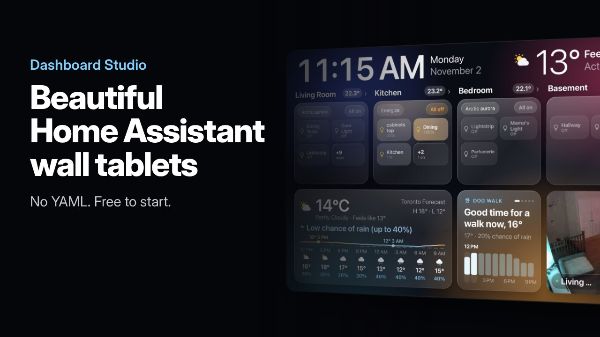

# Dashboard Studio for Home Assistant

**A wall that is awake.** Dashboard Studio turns a tablet on your wall into a calm screen that knows your home. It shows what matters right now: who is at the door, what is playing, what is still open, and what the weather will do. It wakes when you walk up, talks when you ask, and rests when you sleep.

It reads the rooms and devices you already have in Home Assistant and builds your first screen by itself, in about a minute. Everything runs in your own Home Assistant. More at [lukaps.com/dashboardstudio](https://lukaps.com/dashboardstudio/)

## A day with Dashboard Studio

1. **Morning.** You walk into the kitchen and the tablet wakes. It says if you need an umbrella, and when the rain stops.
2. **Leaving.** The screen by the door tells you a window is still open before you go.
3. **Rain.** When it rains outside, drops gather on the glass of the screen. When it snows, it snows there too.
4. **The doorbell.** Every tablet shows the door camera with large buttons. On the TV, the show pauses.
5. **Coming home.** The wall says welcome, by name.
6. **Night.** The screens dim. Walk by in the dark, and a soft path of light shows the way.

Ask any tablet "Is anyone in the kitchen?" or "Turn off the lights downstairs", and it answers out loud. Each wall tablet can be a voice satellite for Home Assistant, with its own wake word.

## Get started in three steps

1. **Install** Dashboard Studio (see below). Open it in the Home Assistant sidebar.
2. **Publish.** Your first screen is already made from your own rooms and devices. Press **Publish to my screens**.
3. **Put it on a wall.** Scan the code on the last step with an Android or Fire tablet, and install our free **Dashboard Studio Wall** app. Pick the room the tablet hangs in. The tablet then shows you, in 20 seconds, what it can do.

An iPad, a phone or a computer needs no app: open your Home Assistant address followed by `/hadash/index.html`.

## Free and Pro

Free gives you a complete wall:

1. The studio, to design every screen in any browser, with five looks.
2. The first screen built from your home, and the free wall app.
3. The doorbell on every tablet, the forecast, music, lights, scenes, cameras and family.
4. Room presence, a guest phone remote, energy tips without an energy meter, and one learned habit.
5. Home on TV: the dashboard comes up when a Fire TV rests.

Pro adds the moments that make the wall feel alive:

1. Weather on the glass, Welcome home, the night path and the home that talks first.
2. Talk to the wall: voice on every tablet, in English, French, German and Spanish.
3. A screen for each room, the Living dashboard that changes with the time of day, and more looks.
4. Intercom between rooms, talking at the front door, and hand gestures.
5. Play on the TV, Room to room, Home replay and every learned habit.

Pro is US$19 until 31 December 2026, then US$29. Every new home gets a 14-day trial of everything.

## Private by design

Your home data stays in your Home Assistant. The tablets talk only to your Home Assistant. Voice listens for the wake word on the tablet itself, and nothing leaves the tablet until it hears it. Room presence sends only a number, never a picture.

## Install in Home Assistant 2026.11 or later (Marketplace)

The button opens Dashboard Studio in your own Home Assistant. You can also follow these steps.

1. Go to **Settings > Marketplace**. The first time, tick **I understand the risks and agree**.
2. Choose **Add from link** and enter `https://github.com/Radushka/ha-dashboard-studio`. Home Assistant asks you to connect GitHub once, with a short code.
3. Install **Dashboard Studio**. No restart is needed.
4. Press **Set up** to finish. Dashboard Studio then appears in the sidebar.

## Install in Home Assistant 2026.10 (HACS)

1. In HACS, open the menu (⋮) and choose **Custom repositories**.
2. Add `https://github.com/Radushka/ha-dashboard-studio` with the type **Integration**.
3. Find **Dashboard Studio** in HACS and download it.
4. Restart Home Assistant.
5. Go to **Settings > Devices & services > Add integration** and add **Dashboard Studio**.

If you update from 2026.10 to 2026.11, you do not need to do anything. Home Assistant moves Dashboard Studio from HACS to the Marketplace by itself, and updates keep working.

## Install by hand

1. Download `hadash.zip` from the newest [release](https://github.com/Radushka/ha-dashboard-studio/releases).
2. Unpack it into `config/custom_components/hadash/`.
3. Restart Home Assistant and add the integration in Settings > Devices & services.

## Home on TV (beta)

On a Fire TV, the dashboard can come up when the TV rests. Turn on ADB debugging on the TV (Settings > My Fire TV > Developer options), then choose **Add a Fire TV** in the studio's ⋯ menu. Home Assistant installs the free Dashboard Studio Wall app and sets it up. The TV asks once to allow it. Works on Fire TV Stick 4K Max, Fire TV Cube and TVs with Fire TV built in, not on the Vega OS models.

## Requirements

Home Assistant 2026.10 or later. Tablets: any Android or Fire tablet for the wall app, or any browser.

## Help

[Support page](https://lukaps.com/dashboardstudio/support/) or support@lukaps.com. To report a bug, open an [issue](https://github.com/Radushka/ha-dashboard-studio/issues).

Amazon, Fire and Fire TV are trademarks of Amazon.com, Inc. or its affiliates. Home Assistant is a trademark of the Open Home Foundation. Dashboard Studio is an independent product and is not affiliated with or endorsed by Amazon or the Home Assistant project.

© 2026 ARB Consulting Inc.
