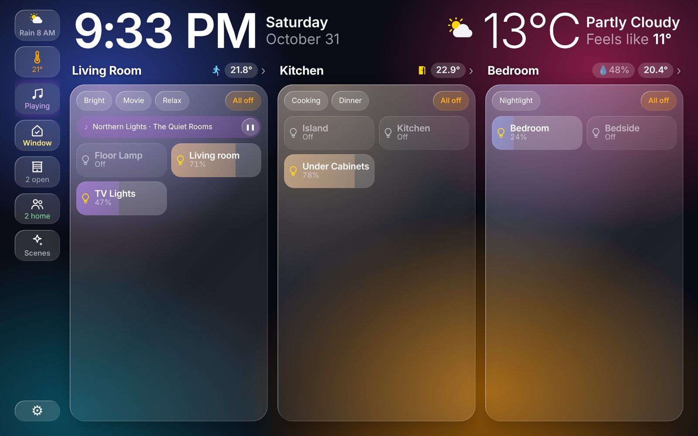

# Dashboard Studio for Home Assistant

Beautiful dashboards for Home Assistant wall tablets: a glass look, large calm type, and rooms first. This integration serves the dashboard to your tablets and keeps your layout. Design it in the web studio inside Home Assistant, or in the [Dashboard Studio Mac app](https://lukaps.com/dashboardstudio/).

## Install with HACS

1. In HACS, open the menu (⋮) and choose **Custom repositories**.
2. Add `https://github.com/Radushka/ha-dashboard-studio` with the type **Integration**.
3. Find **Dashboard Studio** in HACS and download it.
4. Restart Home Assistant.
5. Go to **Settings > Devices & services > Add integration** and add **Dashboard Studio**.

## Install by hand

1. Download `hadash.zip` from the newest [release](https://github.com/Radushka/ha-dashboard-studio/releases).
2. Unpack it into `config/custom_components/hadash/`.
3. Restart Home Assistant and add the integration as in step 5 above.

## Use it

1. Open **Dashboard Studio** in the Home Assistant sidebar to design your dashboard, then click **Publish**.
2. On each tablet, open your Home Assistant address followed by `/hadash/index.html`. On Amazon Fire tablets, Fully Kiosk Browser works well. If a tablet cannot open `.local` addresses, use the IP address of Home Assistant.

Tablets pick up a new layout by themselves.

## Requirements

Home Assistant 2026.10 or later.

## Help

[Support page](https://lukaps.com/dashboardstudio/support/) or support@lukaps.com.

© 2026 ARB Consulting Inc.
