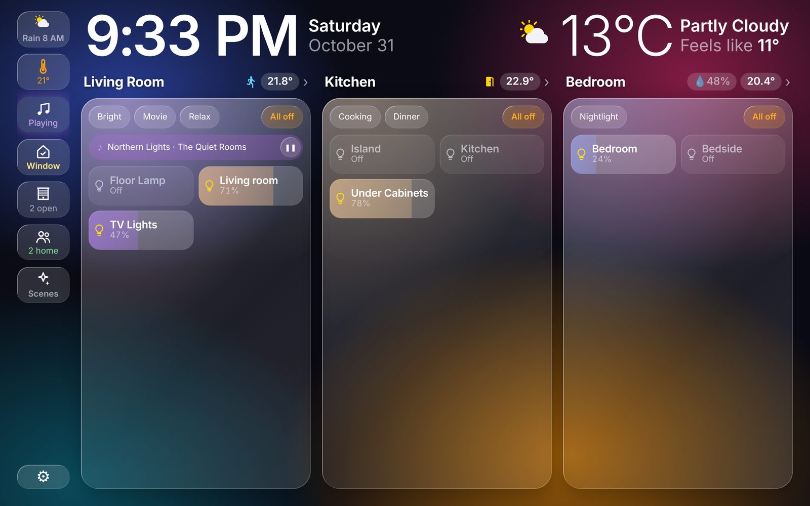

# Dashboard Studio for Home Assistant

Beautiful dashboards for Home Assistant wall tablets: a glass look, large calm type, and rooms first. This integration serves the dashboard to your tablets and keeps your layout. Design it in the studio inside Home Assistant, in any browser. More at [lukaps.com/dashboardstudio](https://lukaps.com/dashboardstudio/)

## Install in Home Assistant 2026.11 or later (Marketplace)

The button opens Dashboard Studio in your own Home Assistant. You can also follow these steps.

1. Go to **Settings > Marketplace**. The first time, tick **I understand the risks and agree**.
2. Choose **Add from link** and enter `https://github.com/Radushka/ha-dashboard-studio`. Home Assistant asks you to connect GitHub once, with a short code.
3. Install **Dashboard Studio**. No restart is needed.
4. Press **Set up** to finish. Dashboard Studio then appears in the sidebar.

## Install in Home Assistant 2026.10 (HACS)

1. In HACS, open the menu (⋮) and choose **Custom repositories**.
2. Add `https://github.com/Radushka/ha-dashboard-studio` with the type **Integration**.
3. Find **Dashboard Studio** in HACS and download it.
4. Restart Home Assistant.
5. Go to **Settings > Devices & services > Add integration** and add **Dashboard Studio**.

If you update from 2026.10 to 2026.11, you do not need to do anything. Home Assistant moves Dashboard Studio from HACS to the Marketplace by itself, and updates keep working.

## Install by hand

1. Download `hadash.zip` from the newest [release](https://github.com/Radushka/ha-dashboard-studio/releases).
2. Unpack it into `config/custom_components/hadash/`.
3. Restart Home Assistant and add the integration in Settings > Devices & services.

## Use it

1. Open **Dashboard Studio** in the Home Assistant sidebar to design your dashboard, then click **Publish**.
2. On each tablet, open your Home Assistant address followed by `/hadash/index.html`. On Amazon Fire tablets, Fully Kiosk Browser works well. If a tablet cannot open `.local` addresses, use the IP address of Home Assistant.

Tablets pick up a new layout by themselves.

## Home on TV (beta)

On a Fire TV, the dashboard can come up when the TV rests. Turn on ADB debugging on the TV (Settings > My Fire TV > Developer options), then choose **Add a Fire TV** in the studio's ⋯ menu. Home Assistant installs the free Dashboard Studio Wall app and sets it up. The TV asks once to allow it. Works on Fire TV Stick 4K Max, Fire TV Cube and TVs with Fire TV built in, not on the Vega OS models.

## Requirements

Home Assistant 2026.10 or later.

## Help

[Support page](https://lukaps.com/dashboardstudio/support/) or support@lukaps.com. To report a bug, open an [issue](https://github.com/Radushka/ha-dashboard-studio/issues).

Amazon, Fire and Fire TV are trademarks of Amazon.com, Inc. or its affiliates. Home Assistant is a trademark of the Open Home Foundation. Dashboard Studio is an independent product and is not affiliated with or endorsed by Amazon or the Home Assistant project.

© 2026 ARB Consulting Inc.
